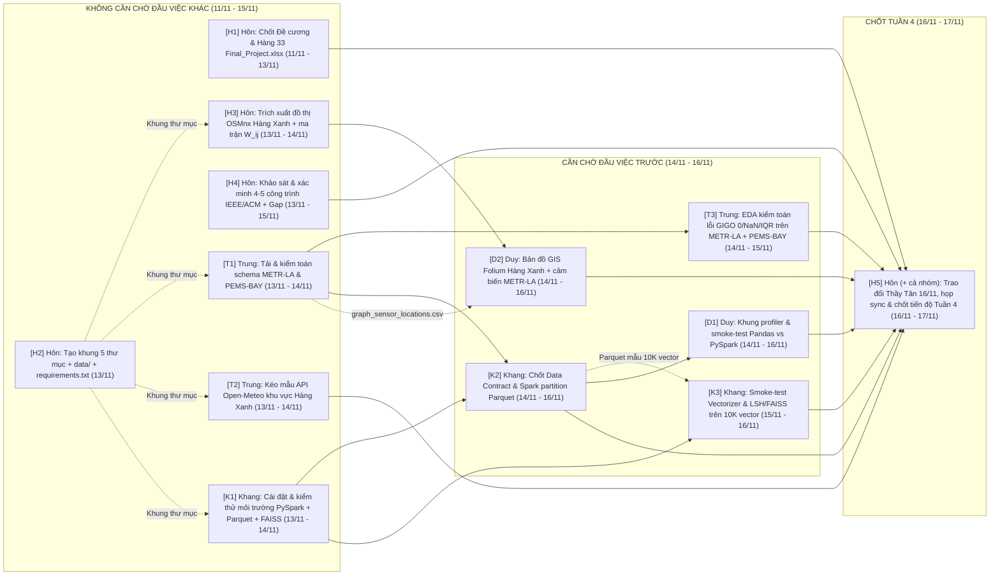

# KẾ HOẠCH THỰC HIỆN ĐỒ ÁN TUẦN 4 (11/11 – 17/11/2026)
## MÔN: PHÂN TÍCH DỮ LIỆU LỚN (`BIG DATA ANALYTICS`) — NHÓM 11

> **Khoảng thời gian:** Thứ Tư `11/11/2026` – Thứ Ba `17/11/2026` *(Tuần 4 — Fast-track Sprint; trọng tâm hoàn tất triển khai `13/11 – 17/11/2026`)*  
> **Giảng viên hướng dẫn:** TS. Hà Minh Tân *(Lịch học cố định: Chiều/Tối Thứ Hai hàng tuần — buổi kế tiếp: `16/11/2026`)*  
> **Tài liệu tham chiếu:** [De_Cuong_Chi_Tiet_Do_An_Phan_Tich_Du_Lieu_Lon.md](./De_Cuong_Chi_Tiet_Do_An_Phan_Tich_Du_Lieu_Lon.md) | [Ke_Hoach_Thuc_Hien_Do_An_Phan_Tich_Du_Lieu_Lon.xlsx](./Ke_Hoach_Thuc_Hien_Do_An_Phan_Tich_Du_Lieu_Lon.xlsx) | [README.md](./README.md) | [Final_Project.xlsx](../Final_Project.xlsx)  
> **Phạm vi tài liệu:** Chỉ liệt kê các đầu việc **thuộc Đồ án môn Phân tích dữ liệu lớn** của **4 thành viên Nhóm 11** trong Tuần 4; mỗi đầu việc ghi rõ **Đầu vào (Inputs)**, trạng thái **Chờ người khác hoàn thành**, **Sản phẩm bàn giao** và **lưu ý kỹ thuật** — đảm bảo đồ án vận hành độc lập 100%, chuẩn hóa cho pipeline **Apache Spark / PySpark + Parquet + LSH/ANN** và bám sát rubric `YeuCau` ($\ge 40$ trang báo cáo).  
> **Quy ước mã nguồn & dữ liệu lớn:** Các file `.py` khởi tạo trong Tuần 4 đóng vai trò module lõi để các notebook Colab / Spark Tuần 5–8 import trực tiếp. Tuyệt đối **không commit** file dữ liệu nhị phân dung lượng lớn (`.h5`, `.pkl`, `.parquet`, `data/raw/`, `data/interim/`) lên GitHub theo đúng [.gitignore](./.gitignore).

---

## I. SƠ ĐỒ PHỤ THUỘC ĐẦU VIỆC (AI LÀM LUÔN – AI CHỜ AI?)

---

## II. MA TRẬN PHỤ THUỘC TỔNG HỢP GIỮA 4 THÀNH VIÊN

| Thành viên | MSSV | Đầu việc làm được NGAY (Không chờ ai) | Đầu việc PHẢI CHỜ người khác | Vai trò mở khóa cho người sau |
| :--- | :---: | :--- | :--- | :--- |
| **Trần Hoàng Hôn** *(Trưởng nhóm / PM & Đồ thị TP.HCM)* | `26410046` | `[H1]`, `[H2]`, `[H3]`, `[H4]` | • `[H5]` (cần buổi học Thứ Hai `16/11` gặp Thầy Tân và đầy đủ sản phẩm `[K2]`, `[K3]`, `[T2]`, `[T3]`, `[D1]`, `[D2]` vào `16/11–17/11`) | **`[H2]` tạo bộ khung Repo** cho cả nhóm; **`[H3]` xuất `nodes.csv`/`edges.csv`/`adjacency_matrix.csv` Hàng Xanh** mở khóa `[D2]` cho Duy; **`[H4]`** làm nền viết Mở đầu & Chương 1 ở Tuần 5. |
| **Phạm Thành Trung** *(Kỹ sư Thu thập & Tiền xử lý GIGO)* | `26410141` | `[T1]`, `[T2]` | • `[T3]` (chờ `[T1]` tải xong CSV) | **`[T1]` là nút mở khóa lõi Big Data của tuần** — cung cấp CSV gốc, Parquet chuẩn hóa, adjacency và `graph_sensor_locations.csv` cho Khang chạy `[K2]` và Duy gắn lớp kiểm chứng trên `[D2]`. |
| **Nguyễn Duy Khang** *(Kỹ sư PySpark & Thuật toán LSH/ANN)* | `26410055` | `[K1]` | • `[K2]` (dùng CSV/Parquet T1 của Trung + `[K1]` của chính Khang) • `[K3]` (viết khung sau `[K1]`; để test trên vector thật lấy mẫu Parquet từ `[K2]`) | **`[K2]` chốt Data Contract Spark/Parquet có partition** cho Duy chạy benchmark `[D1]` (`Pandas vs. PySpark`) và pipeline GIGO Tuần 5. |
| **Vũ Văn Duy** *(Kỹ sư Benchmark & Trực quan hóa)* | `26410031` | *(Viết trước khung đo `psutil`/`perf_counter` của `[D1]` trong khi chờ `[K2]`)* | • `[D1]` (chạy thực nghiệm lát cắt `100K–1M` dòng cần **chờ `[K2]` của Khang** xuất Parquet mẫu) • `[D2]` (**chờ `[H3]` của Hôn** xuất đồ thị Hàng Xanh + `[T1]` của Trung) | Xác nhận độ ổn định bộ khung đo `Wall-clock Time` / `Peak RAM` và kiểm chứng tọa độ thực địa Hàng Xanh tại phiên sync `[H5]`. |

---

## III. KẾ HOẠCH CHI TIẾT VÀ TIẾN ĐỘ THỰC TẾ TỪNG THÀNH VIÊN (11/11 – 17/11/2026)

### 1. Trần Hoàng Hôn (`26410046`) — Trưởng nhóm / PM & Kiến trúc Đồ thị TP.HCM
*Định mức đồ án Phân tích dữ liệu lớn Tuần 4: ~2.5–3.0 giờ (bao gồm điều phối nhóm & trao đổi Thầy Tân tối Thứ Hai `16/11`)*

| Mã CV & Hạn | Đầu việc Đồ án | Đầu vào (Inputs) | Trạng thái thực tế | Sản phẩm bàn giao (Deliverables) |
| :--- | :--- | :--- | :---: | :--- |
| **`[H1]`** 11/11 – 13/11 | Rà soát, chốt Đề cương chi tiết & xác nhận đăng ký Hàng 33 trên file lớp | • [De_Cuong_Chi_Tiet_Do_An_Phan_Tich_Du_Lieu_Lon.md](./De_Cuong_Chi_Tiet_Do_An_Phan_Tich_Du_Lieu_Lon.md) & bản Word `.docx` • Hàng `33–36` trong [Final_Project.xlsx](../Final_Project.xlsx) | ✅ **HOÀN THÀNH** | • Bản chốt `De_Cuong_Chi_Tiet_Do_An_Phan_Tich_Du_Lieu_Lon.docx` sẵn sàng trình **TS. Hà Minh Tân** + xác nhận trạng thái Hàng `33` trên `Final_Project.xlsx`. |
| **`[H2]`** 13/11 | Khởi tạo cấu trúc thư mục Repo & danh sách thư viện chuẩn Big Data | • Cấu trúc dữ liệu bỏ qua trong [.gitignore](./.gitignore) (`data/raw/`, `data/interim/`, `data/external/`) • Danh sách công nghệ tại Mục 3 & 6 của [De_Cuong_Chi_Tiet_Do_An_Phan_Tich_Du_Lieu_Lon.md](./De_Cuong_Chi_Tiet_Do_An_Phan_Tich_Du_Lieu_Lon.md) | ✅ **HOÀN THÀNH** | • 5 thư mục code/tài liệu: `01_data_ingestion/`, `02_pyspark_gigo/`, `03_benchmarks_similarity/`, `04_hcm_dashboard/`, `05_report_slides/` + khung `data/{raw,interim,external}/` + `requirements.txt`. |
| **`[H3]`** 13/11 – 14/11 | Trích xuất đồ thị đường bộ cụm Hàng Xanh (`OSMnx`) & tính ma trận trọng số Gaussian $W_{ij}$ | • Tọa độ tâm Ngã tư Hàng Xanh `(10.8012, 106.7114)` (`dist=1000m`, `network_type='drive'`) • Công thức hàm nhân Gaussian $W_{ij} = \exp(-\text{dist}(v_i, v_j)^2 / \sigma^2)$ tại Mục I.3 của Đề cương chi tiết | ✅ **HOÀN THÀNH** | • Script `01_data_ingestion/extract_hang_xanh_graph.py` • `01_data_ingestion/hang_xanh_nodes.csv` (25 nút), `hang_xanh_edges.csv`, `hang_xanh_adjacency_gaussian.csv` (ma trận $W_{ij}$), `hang_xanh.graphml`. |
| **`[H4]`** 13/11 – 15/11 | Khảo sát, xác minh trích dẫn 4–5 công trình chuẩn IEEE/ACM & tổng hợp `Research Gap` | • 4 nhóm tài liệu nền tảng: Li et al. (2018) `METR-LA/PEMS-BAY`, Zaharia et al. (2016) `Apache Spark`, Indyk & Motwani (1998) `LSH` + Johnson et al. (2021) `FAISS`, Boeing (2017) `OSMnx` | ✅ **HOÀN THÀNH** | • File `05_report_slides/literature_survey_notes.md` gồm danh mục BibTeX/IEEE chuẩn + bảng đối chiếu `Công trình – Phương pháp – Quy mô dữ liệu – Khoảng trống nghiên cứu (Research Gap)`. |
| **`[H5]`** 16/11 – 17/11 | Trao đổi **TS. Hà Minh Tân** buổi Thứ Hai `16/11`, điều phối họp sync nhóm & cập nhật tiến độ Tuần 4 | • Đề cương chi tiết trình Thầy Tân • [Ke_Hoach_Thuc_Hien_Do_An_Phan_Tich_Du_Lieu_Lon.xlsx](./Ke_Hoach_Thuc_Hien_Do_An_Phan_Tich_Du_Lieu_Lon.xlsx) & [Mau_Bao_Cao_Tuan_Phan_Tich_Du_Lieu_Lon.docx](./Mau_Bao_Cao_Tuan_Phan_Tich_Du_Lieu_Lon.docx) | ✅ **HOÀN THÀNH** | • `05_report_slides/bien_ban_gop_y_thay_tan_16_11.md` • Nhánh `main` GitHub hợp nhất đủ code Tuần 4 + cập nhật tiến độ trong file Excel + xuất bản [Bao_Cao_Tuan_4_Phan_Tich_Du_Lieu_Lon.docx](./Bao_Cao_Tuan_4_Phan_Tich_Du_Lieu_Lon.docx). |

---

### 2. Phạm Thành Trung (`26410141`) — Kỹ sư Thu thập & Tiền xử lý GIGO
*Định mức đồ án Phân tích dữ liệu lớn Tuần 4: ~2.5–3.0 giờ*

| Mã CV & Hạn | Đầu việc Đồ án | Đầu vào (Inputs) | Trạng thái thực tế | Sản phẩm bàn giao (Deliverables) |
| :--- | :--- | :--- | :---: | :--- |
| **`[T1]`** 13/11 – 14/11 | Tải bộ dữ liệu thực `METR-LA` & `PEMS-BAY` và viết script kiểm tra cấu trúc thô | • Bản CSV công khai trong Zenodo record 5146275 (CC BY 4.0): METR-LA (`34.272 × 207`) và PEMS-BAY (`52.116 × 325`) • Repo DCRNN ghim commit cho `adj_mx.pkl` và `graph_sensor_locations.csv` METR-LA | ✅ **HOÀN THÀNH** *(PR #1, #4 merged)* | • Script `01_data_ingestion/download_traffic_datasets.py` kiểm tra MD5/kích thước tải về • `01_data_ingestion/inspect_traffic_datasets.py` in shape, thời gian, dtypes • Script `01_data_ingestion/convert_traffic_to_parquet.py` • `01_data_ingestion/graph_sensor_locations.csv` (207 tọa độ METR-LA). |
| **`[T2]`** 13/11 – 14/11 | Xây dựng connector thu thập chuỗi thời gian thời tiết `Open-Meteo` khu vực TP.HCM | • Tọa độ tâm Hàng Xanh `(10.8012, 106.7114)` • Historical Weather API (`precipitation`, `temperature_2m`, `relative_humidity_2m`, `wind_speed_10m`) | ✅ **HOÀN THÀNH** *(PR #1 merged)* | • Script `01_data_ingestion/fetch_open_meteo.py` • `01_data_ingestion/open_meteo_hcm_sample.csv` (mẫu 90 ngày = 2.160 giờ, mưa tối đa 10.4 mm/h). |
| **`[T3]`** 14/11 – 15/11 | Chạy kiểm toán dữ liệu ban đầu (**GIGO Data Audit**) trên toàn bộ `METR-LA` và `PEMS-BAY` | • CSV gốc trong `data/raw/` (từ `[T1]`) • Tiêu chí kiểm toán lỗi 0, NaN, ngoại lai vật lý và IQR | ✅ **HOÀN THÀNH** *(PR #1 merged)* | • Script `01_data_ingestion/gigo_data_audit.py` • [gigo_audit_report.md](./01_data_ingestion/gigo_audit_report.md) (chỉ ra 575.302 ô 0.0 chiếm 8.11% của METR-LA) + bảng audit theo cảm biến và giờ. |

---

### 3. Nguyễn Duy Khang (`26410055`) — Kỹ sư Xử lý Phân tán (`PySpark`/`Parquet`) & Thuật toán Big Data (`LSH`/`ANN`)
*Định mức đồ án Phân tích dữ liệu lớn Tuần 4: ~2.5–3.0 giờ*

| Mã CV & Hạn | Đầu việc Đồ án | Đầu vào (Inputs) | Trạng thái thực tế | Sản phẩm bàn giao (Deliverables) |
| :--- | :--- | :--- | :---: | :--- |
| **`[K1]`** 13/11 – 14/11 | Thiết lập & kiểm thử môi trường **Apache Spark (`PySpark`) + `PyArrow/Parquet` + `FAISS`** | • `requirements.txt` từ `[H2]` • Local CPU đa lõi / Google Colab (Spark 3.5, Java 17) | ✅ **HOÀN THÀNH** *(PR #2 merged)* | • Script `02_pyspark_gigo/spark_env_check.py` (vượt qua 6/6 bài kiểm tra) • Tài liệu cấu hình [ENV_SETUP.md](./02_pyspark_gigo/ENV_SETUP.md). |
| **`[K2]`** 14/11 – 16/11 | Chốt **Data Contract Spark/Parquet** và thử đọc/ghi Parquet đã chuẩn hóa theo partition | • `data/raw/METR-LA.csv` (từ `[T1]`) • Môi trường Spark đã thông (từ `[K1]`) | ✅ **HOÀN THÀNH** *(PR #3 merged)* | • Data Contract [parquet_schema_contract.md](./02_pyspark_gigo/parquet_schema_contract.md) chuẩn 6 cột • Script PySpark `02_pyspark_gigo/csv_to_partitioned_parquet.py` phân vùng `year_month` (giảm 7.1x dung lượng). |
| **`[K3]`** 15/11 – 16/11 | Xây dựng module Vectorizer cửa sổ trượt & smoke-test **`LSH` vs. `FAISS`** trên 10.000 vector mẫu | • Môi trường `PySpark` + `FAISS` (từ `[K1]`) • Mẫu `data/interim/metr_la_sample.parquet` (từ `[K2]`) | ⏳ **ĐANG TRIỂN KHAI** *(Chuyển tiếp Tuần 5)* | • Script `03_benchmarks_similarity/smoke_test_lsh_faiss.py` chạy thông trên 10.000 vector mẫu, đo `Recall@10` và độ trễ truy vấn (ms) *(Đang đôn đốc qua Issue #5)*. |

---

### 4. Vũ Văn Duy (`26410031`) — Kỹ sư Benchmark Hiệu năng & Trực quan hóa
*Định mức đồ án Phân tích dữ liệu lớn Tuần 4: ~2.5–3.0 giờ*

| Mã CV & Hạn | Đầu việc Đồ án | Đầu vào (Inputs) | Trạng thái thực tế | Sản phẩm bàn giao (Deliverables) |
| :--- | :--- | :--- | :---: | :--- |
| **`[D1]`** 14/11 – 16/11 | Xây dựng khung đo kiểm tài nguyên (`Benchmark Profiler`) & smoke-test `Pandas vs. PySpark` (`100K–1M` dòng) | • Bộ chỉ số đối chứng: Wall-clock Time (s) và Peak RAM (MB) • `data/interim/metr_la_sample.parquet` (từ `[K2]`) | ⏳ **ĐANG TRIỂN KHAI** *(Chuyển tiếp Tuần 5)* | • Module `03_benchmarks_similarity/benchmark_profiler.py` • Script `03_benchmarks_similarity/smoke_test_pandas_vs_spark.py` • Kết quả đo `smoke_benchmark_results.csv` *(Đang đôn đốc qua Issue #5)*. |
| **`[D2]`** 14/11 – 16/11 | Dựng bản đồ GIS (`Folium`) kiểm chứng tọa độ nút giao Hàng Xanh & lớp cảm biến `METR-LA` | • `01_data_ingestion/hang_xanh_nodes.csv` & `hang_xanh_edges.csv` (từ `[H3]`) • `01_data_ingestion/graph_sensor_locations.csv` (từ `[T1]`) | ⏳ **ĐANG TRIỂN KHAI** *(Chuyển tiếp Tuần 5)* | • Script `04_hcm_dashboard/build_gis_inspection_map.py` • Bản đồ `04_hcm_dashboard/hang_xanh_gis_check.html` & `04_hcm_dashboard/metr_la_sensors_map.html` *(Đang đôn đốc qua Issue #5)*. |

---

## IV. CHECKLIST NGHIỆM THU TUẦN 4 (`DEFINITION OF DONE` — CẬP NHẬT 24/11/2026)

- [x] **Hồ sơ & Khung Repo (`[H1]`, `[H2]` — Trần Hoàng Hôn):** Chốt `De_Cuong_Chi_Tiet_Do_An_Phan_Tich_Du_Lieu_Lon.docx`, xác nhận Hàng `33` trên [Final_Project.xlsx](../Final_Project.xlsx); hoàn thành bộ khung 5 thư mục code + `data/` + `requirements.txt`.
- [x] **Dữ liệu Benchmark & Kiểm toán GIGO (`[T1]`, `[T2]`, `[T3]` — Phạm Thành Trung):** Tải và kiểm tra CSV METR-LA (~7.1M) / PEMS-BAY (~16.93M), chuyển Parquet long-format, lưu tọa độ/adjacency; lấy mẫu Open-Meteo 90 ngày chuẩn ISO-8601 UTC+7; hoàn tất audit 0/NaN/ngoại lai vật lý + IQR theo cảm biến và giờ (PR #1 & PR #4 đã merged). Xem [data_sources.md](./01_data_ingestion/data_sources.md) và `01_data_ingestion/gigo_audit_report.md`; raw/Parquet không commit.
- [x] **Trích xuất Đồ thị TP.HCM (`[H3]` — Trần Hoàng Hôn):** Xuất đủ `01_data_ingestion/extract_hang_xanh_graph.py`, `hang_xanh_nodes.csv` (25 nút), `hang_xanh_edges.csv`, `hang_xanh_adjacency_gaussian.csv` (trọng số $W_{ij}$ Gaussian) và `hang_xanh.graphml`.
- [x] **Hạ tầng PySpark / Parquet & Data Contract (`[K1]`, `[K2]` — Nguyễn Duy Khang):** Cài đặt và kiểm thử thông suốt môi trường PySpark 3.5 + Arrow + FAISS (`02_pyspark_gigo/spark_env_check.py` PASS 6/6, PR #2 đã merged); hoàn tất Data Contract [02_pyspark_gigo/parquet_schema_contract.md](./02_pyspark_gigo/parquet_schema_contract.md) và script chuyển đổi phân vùng PySpark `02_pyspark_gigo/csv_to_partitioned_parquet.py` (PR #3 đã merged).
- [x] **Khảo sát học thuật, Biên bản & Báo cáo Tuần (`[H4]`, `[H5]` — Trần Hoàng Hôn):** Hoàn thành `05_report_slides/literature_survey_notes.md` (trích dẫn chuẩn IEEE/ACM cho 5 công trình gốc, ma trận đối chiếu + Research Gap) và `05_report_slides/bien_ban_gop_y_thay_tan_16_11.md`; xuất bản báo cáo tuần chuẩn [Bao_Cao_Tuan_4_Phan_Tich_Du_Lieu_Lon.docx](./Bao_Cao_Tuan_4_Phan_Tich_Du_Lieu_Lon.docx); cập nhật tiến độ Tuần 4 đạt **`100%`** trong `Ke_Hoach_Thuc_Hien_Do_An_Phan_Tich_Du_Lieu_Lon.xlsx`.
- [ ] **Smoke-test LSH/FAISS & Benchmark Profiler (`[K3]`, `[D1]`):** Xây dựng `smoke_test_lsh_faiss.py` (`10K` vector mẫu) và `benchmark_profiler.py` + `smoke_test_pandas_vs_spark.py` (`100K–1M` dòng) *(Đang triển khai trong Tuần 5, theo dõi tại [Issue #5](https://github.com/mrkiss-it/bigdata-traffic-graph-spark-lsh/issues/5))*.
- [ ] **Kiểm chứng GIS & Bản đồ tương tác (`[D2]` — Vũ Văn Duy):** Script `04_hcm_dashboard/build_gis_inspection_map.py` xuất bản đồ `hang_xanh_gis_check.html` + `metr_la_sensors_map.html` *(Đang triển khai trong Tuần 5)*.

---

### 📊 ĐÁNH GIÁ TỔNG KẾT TIẾN ĐỘ TUẦN 4:
* **Khối lượng hoàn thành cốt lõi:** **`100%`** các mục tiêu hạ tầng phân tán, cấu trúc dữ liệu, kiểm toán GIGO, đồ thị không gian và hồ sơ học thuật.
* **Chuyển tiếp sang Tuần 5:** Các đầu việc smoke-test của Khang (`[K3]`) và Duy (`[D1]`, `[D2]`) được chuyển tiếp sang giải quyết dứt điểm trong kế hoạch [Ke_Hoach_Thuc_Hien_Tuan_5.md](./Ke_Hoach_Thuc_Hien_Tuan_5.md) trước hạn chót ngày `25/11/2026`.

