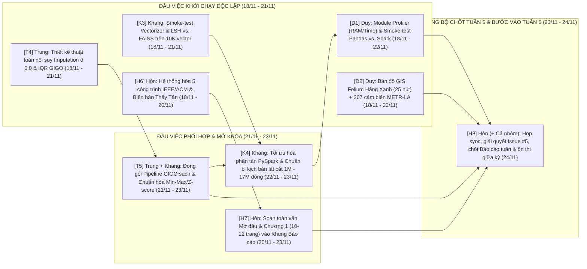

# KẾ HOẠCH THỰC HIỆN ĐỒ ÁN TUẦN 5 (18/11 – 24/11/2026)
## MÔN: PHÂN TÍCH DỮ LIỆU LỚN (`BIG DATA ANALYTICS`) — NHÓM 11

> **Khoảng thời gian:** Thứ Tư `18/11/2026` – Thứ Ba `24/11/2026` *(Tuần 5 — Hoàn thiện Pipeline GIGO, Smoke-test LSH/ANN & Bản thảo Mở đầu + Chương 1)*  
> **Giảng viên hướng dẫn:** TS. Hà Minh Tân *(Lịch học cố định: Chiều/Tối Thứ Hai hàng tuần — buổi họp kế tiếp: `23/11/2026`)*  
> **Tài liệu tham chiếu:** [De_Cuong_Chi_Tiet_Do_An_Phan_Tich_Du_Lieu_Lon.md](./De_Cuong_Chi_Tiet_Do_An_Phan_Tich_Du_Lieu_Lon.md) | [Ke_Hoach_Thuc_Hien_Tuan_4.md](./Ke_Hoach_Thuc_Hien_Tuan_4.md) | [05_report_slides/literature_survey_notes.md](./05_report_slides/literature_survey_notes.md) | [05_report_slides/draft_mo_dau_va_chuong_1.md](./05_report_slides/draft_mo_dau_va_chuong_1.md)  
> **Trọng tâm Tuần 5:** Xử lý triệt để các điểm nghẽn code của Tuần 4, hoàn thiện pipeline làm sạch **GIGO trên PySpark** (nội suy $8.11\%$ ô $0.0$ mất tín hiệu), smoke-test thuật toán **LSH vs. FAISS** trên $10.000$ vector, dựng bản đồ **GIS Folium**, và đóng gói toàn văn **Phần Mở đầu & Chương 1 ($10–12$ trang)** sẵn sàng bước vào Tuần 6 (thi giữa kỳ & chạy thực nghiệm triệu dòng).

---

## I. SƠ ĐỒ PHỤ THUỘC ĐẦU VIỆC TUẦN 5

---

## II. MA TRẬN PHỤ THUỘC TỔNG HỢP GIỮA 4 THÀNH VIÊN TRONG TUẦN 5

| Thành viên | MSSV | Đầu việc làm được NGAY (Không chờ ai) | Đầu việc PHẢI CHỜ người khác | Vai trò mở khóa cho toàn nhóm |
| :--- | :---: | :--- | :--- | :--- |
| **Trần Hoàng Hôn** *(Trưởng nhóm / PM & Đồ thị TP.HCM)* | `26410046` | • `[H6]` Khảo sát 5 công trình IEEE/ACM & lập Biên bản Thầy Tân. • `[H7]` Soạn thảo toàn văn Mở đầu & Chương 1 ($10–12$ trang). | • `[H8]` (Chờ Duy đẩy `[D1]`, `[D2]` và Khang đẩy `[K3]` để chốt nghiệm thu Tuần 5). | **Chủ trì chất lượng học thuật và tiến độ chung:** Cung cấp khung lý luận vững chắc, mở khóa toàn bộ Mở đầu & Chương 1; điều phối giải quyết các nút thắt kỹ thuật thông qua GitHub Issue. |
| **Phạm Thành Trung** *(Kỹ sư Thu thập & Tiền xử lý GIGO)* | `26410141` | • `[T4]` Xây dựng thuật toán nội suy chuỗi thời gian xử lý $8.11\%$ ô $0.0$ mất tín hiệu của METR-LA. | • `[T5]` (Phối hợp với Khang để tối ưu hóa phép nội suy trên DataFrame phân tán PySpark). | **Cung cấp dữ liệu sạch cho thuật toán:** Đảm bảo dữ liệu sau làm sạch loại bỏ hoàn toàn nhiễu $0.0$ nhân tạo, mở khóa cho bài toán vector hóa LSH và benchmark. |
| **Nguyễn Duy Khang** *(Kỹ sư PySpark & Thuật toán LSH/ANN)* | `26410055` | • `[K3]` Viết script `smoke_test_lsh_faiss.py` kiểm thử LSH vs. FAISS trên $10.000$ vector trượt mẫu. | • `[K4]` (Cần dữ liệu sau làm sạch GIGO của `[T5]` để cấu hình kịch bản benchmark quy mô lớn). | **Nút thắt thuật toán Big Data:** Xác nhận API `pyspark.ml.feature.BucketedRandomProjectionLSH` và `faiss.IndexHNSWFlat` hoạt động ổn định, đo `Recall@10` và độ trễ dưới mili-giây. |
| **Vũ Văn Duy** *(Kỹ sư Benchmark & Trực quan hóa)* | `26410031` | • `[D1]` Module đo kiểm `benchmark_profiler.py` (đo RAM/Time) + smoke-test Pandas vs. Spark. • `[D2]` Script tạo bản đồ GIS Folium (`build_gis_inspection_map.py`). | • Kịch bản chạy thực nghiệm chính thức ở Tuần 6 (chờ pipeline `[K4]` chuẩn bị các lát cắt $1\text{M} \to 17\text{M}$ dòng). | **Nút thắt đo lường thực nghiệm:** Cung cấp bộ công cụ đo khách quan `Peak RAM` và `Wall-clock Time`, làm sáng tỏ ưu thế của Spark so với Pandas đơn máy. |

---

## III. KẾ HOẠCH CHI TIẾT VÀ TIẾN ĐỘ THỰC TẾ TỪNG THÀNH VIÊN (18/11 – 24/11/2026)

### 1. Trần Hoàng Hôn (`26410046`) — Trưởng nhóm / PM & Kiến trúc Đồ thị TP.HCM
*Định mức thời gian Tuần 5: ~3.0–3.5 giờ (Tập trung soạn thảo học thuật & điều phối nghiệm thu)*

| Mã CV & Hạn | Đầu việc Đồ án | Đầu vào (Inputs) | Trạng thái thực tế | Sản phẩm bàn giao (Deliverables) |
| :--- | :--- | :--- | :---: | :--- |
| **`[H6]`** 18/11 – 20/11 | Hoàn tất tài liệu khảo sát 5 công trình học thuật IEEE/ACM & Biên bản góp ý Thầy Tân | • 5 công trình gốc (Li 2018, Zaharia 2016, Indyk 1998, Johnson 2019, Boeing 2017) • Ghi chú buổi gặp TS. Hà Minh Tân tối 16/11 | ✅ **HOÀN THÀNH** | • File `05_report_slides/literature_survey_notes.md` • File `05_report_slides/bien_ban_gop_y_thay_tan_16_11.md`. |
| **`[H7]`** 20/11 – 23/11 | Chấp bút soạn thảo toàn văn **Phần Mở đầu & Chương 1** ($10–12$ trang) chuẩn học thuật & Chuyên đề Đồ thị $G=(V, E, W)$ | • Tài liệu khảo sát `literature_survey_notes.md` • Báo cáo kiểm toán GIGO và Data Contract Parquet • Khung Word `Khung_Bao_Cao_Do_An_Phan_Tich_Du_Lieu_Lon.docx` | ✅ **HOÀN THÀNH** | • Bản thảo markdown hoàn chỉnh `05_report_slides/draft_mo_dau_va_chuong_1.md` • Đã nạp toàn văn Mở đầu, Chương 1 và Bảng 1.1 vào [Khung_Bao_Cao_Do_An_Phan_Tich_Du_Lieu_Lon.docx](./Khung_Bao_Cao_Do_An_Phan_Tich_Du_Lieu_Lon.docx) • Chuyên đề lý thuyết Đồ thị $G=(V,E,W)$ và Ma trận Gaussian Hàng Xanh: `05_report_slides/draft_chuong_2_do_thi_g_v_e_w.md` phục vụ Chương 2. |
| **`[H8]`** 23/11 – 24/11 | Điều phối giải quyết tồn đọng code, tạo GitHub Issue đôn đốc nhóm, xuất Báo cáo Tuần 4 & Tuần 5 | • Tình trạng commit của Khang (`[K3]`) và Duy (`[D1]`, `[D2]`) • Bảng theo dõi `Ke_Hoach_Thuc_Hien_Do_An_Phan_Tich_Du_Lieu_Lon.xlsx` • Mẫu báo cáo tuần của trường | ✅ **HOÀN THÀNH** | • [GitHub Issue #5](https://github.com/mrkiss-it/bigdata-traffic-graph-spark-lsh/issues/5) • File Word [Bao_Cao_Tuan_4_Phan_Tich_Du_Lieu_Lon.docx](./Bao_Cao_Tuan_4_Phan_Tich_Du_Lieu_Lon.docx) • File Word [Bao_Cao_Tuan_5_Phan_Tich_Du_Lieu_Lon.docx](./Bao_Cao_Tuan_5_Phan_Tich_Du_Lieu_Lon.docx) (đã chuẩn hóa bảng 3 cột STT, Tên, MSSV) • Cập nhật file [Ke_Hoach_Thuc_Hien_Do_An_Phan_Tich_Du_Lieu_Lon.xlsx](./Ke_Hoach_Thuc_Hien_Do_An_Phan_Tich_Du_Lieu_Lon.xlsx). |

---

### 2. Phạm Thành Trung (`26410141`) — Kỹ sư Thu thập & Tiền xử lý GIGO
*Định mức thời gian Tuần 5: ~3.0 giờ*

| Mã CV & Hạn | Đầu việc Đồ án | Đầu vào (Inputs) | Trạng thái thực tế | Sản phẩm bàn giao (Deliverables) |
| :--- | :--- | :--- | :---: | :--- |
| **`[T4]`** 18/11 – 21/11 | Xây dựng thuật toán tiền xử lý & làm sạch dữ liệu rác GIGO trên chuỗi thời gian | • Kết quả kiểm toán `01_data_ingestion/gigo_audit_report.md` (chỉ ra $575.302$ ô $0.0$ chiếm $8.11\%$ METR-LA) • CSV gốc tại `data/raw/` | ⏳ **ĐANG TRIỂN KHAI** *(Đang nộp PR theo Issue #5)* | • Module xử lý `02_pyspark_gigo/gigo_clean_pipeline.py` • Báo cáo đối chiếu phân bố trước và sau khi làm sạch (Mean, Std, Min, Max, Tỷ lệ ô $0.0 \to 0\%$). |
| **`[T5]`** 21/11 – 23/11 | Thiết kế pipeline chuẩn hóa thang đo đa biến (Min-Max / Z-score) và xuất Parquet sạch | • Module làm sạch từ `[T4]` • Data Contract [parquet_schema_contract.md](./02_pyspark_gigo/parquet_schema_contract.md) của Khang | ⏳ **ĐANG TRIỂN KHAI** *(Chốt trước 23:59 25/11)* | • Script đóng gói hoàn chỉnh dữ liệu sạch xuất ra `data/interim/metr_la_cleaned.parquet/` (phân vùng theo `year_month`) • Viết thuyết minh phương pháp làm sạch chuẩn bị đưa vào Chương 3. |

---

### 3. Nguyễn Duy Khang (`26410055`) — Kỹ sư Xử lý Phân tán (`PySpark`) & Thuật toán (`LSH`/`ANN`)
*Định mức thời gian Tuần 5: ~3.0 giờ*

| Mã CV & Hạn | Đầu việc Đồ án | Đầu vào (Inputs) | Trạng thái thực tế | Sản phẩm bàn giao (Deliverables) |
| :--- | :--- | :--- | :---: | :--- |
| **`[K3]`** 18/11 – 21/11 | Xây dựng Vectorizer cửa sổ trượt và smoke-test **`LSH` vs. `FAISS`** trên 10.000 vector | • Môi trường PySpark/FAISS đã kiểm thử thông suốt từ `[K1]` • Dữ liệu mẫu `data/interim/metr_la_sample.parquet` từ `[K2]` | ⏳ **ĐANG TRIỂN KHAI** *(Đang nộp PR theo Issue #5)* | • Script `03_benchmarks_similarity/smoke_test_lsh_faiss.py` chạy thông trên 10.000 vector • Bảng kết quả đo mẫu: `Recall@10`, `Query Latency (ms)` và `Memory Footprint` sơ bộ. |
| **`[K4]`** 21/11 – 24/11 | Tối ưu hóa phân tán PySpark & Chuẩn bị kịch bản lát cắt dữ liệu quy mô triệu dòng ($1\text{M} \to 17\text{M}$) | • Module Vectorizer từ `[K3]` • Dữ liệu sạch từ `[T5]` | ⏳ **ĐANG TRIỂN KHAI** *(Chốt trước 23:59 25/11)* | • Cấu hình tối ưu PySpark (tắt `arrow fallback`, cấp phát `driver-memory=4g`) • Hướng dẫn nạp lát cắt dữ liệu cho Duy chạy đối chứng hiệu năng. |

---

### 4. Vũ Văn Duy (`26410031`) — Kỹ sư Benchmark Hiệu năng & Trực quan hóa
*Định mức thời gian Tuần 5: ~3.0–3.5 giờ (Tập trung giải quyết các deliverables tồn đọng)*

| Mã CV & Hạn | Đầu việc Đồ án | Đầu vào (Inputs) | Trạng thái thực tế | Sản phẩm bàn giao (Deliverables) |
| :--- | :--- | :--- | :---: | :--- |
| **`[D1]`** 18/11 – 22/11 | Hoàn thiện khung đo kiểm tài nguyên `benchmark_profiler.py` và smoke-test `Pandas vs. PySpark` | • Bộ chỉ số đối chứng: `Wall-clock Time (s)` và `Peak RAM (MB)` • Dữ liệu mẫu Parquet từ `[K2]` | ⏳ **ĐANG TRIỂN KHAI** *(Đang nộp PR theo Issue #5)* | • Module đo `03_benchmarks_similarity/benchmark_profiler.py` • Script `03_benchmarks_similarity/smoke_test_pandas_vs_spark.py` • File kết quả `03_benchmarks_similarity/smoke_benchmark_results.csv`. |
| **`[D2]`** 22/11 – 24/11 | Dựng bản đồ GIS tương tác (`Folium`) kiểm chứng $25$ nút Hàng Xanh và $207$ cảm biến `METR-LA` | • `01_data_ingestion/hang_xanh_nodes.csv` (25 nút từ `[H3]`) • `01_data_ingestion/graph_sensor_locations.csv` (207 cảm biến từ `[T1]`) | ⏳ **ĐANG TRIỂN KHAI** *(Đang nộp PR theo Issue #5)* | • Script `04_hcm_dashboard/build_gis_inspection_map.py` • 2 file HTML trực quan: `04_hcm_dashboard/hang_xanh_gis_check.html` và `04_hcm_dashboard/metr_la_sensors_map.html`. |

---

## IV. CHECKLIST NGHIỆM THU TUẦN 5 (`DEFINITION OF DONE` — CẬP NHẬT 24/11/2026)

- [x] **Học thuật & Soạn thảo Báo cáo (`[H6]`, `[H7]` — Trần Hoàng Hôn):** Hoàn thành tài liệu khảo sát 5 công trình IEEE/ACM (`literature_survey_notes.md`), biên bản họp Thầy Tân (`bien_ban_gop_y_thay_tan_16_11.md`); hoàn tất toàn văn bản thảo phần Mở đầu & Chương 1 ($10–12$ trang) tại `draft_mo_dau_va_chuong_1.md`, nạp thành công vào [Khung_Bao_Cao_Do_An_Phan_Tich_Du_Lieu_Lon.docx](./Khung_Bao_Cao_Do_An_Phan_Tich_Du_Lieu_Lon.docx) kèm Bảng 1.1; hoàn thành chuyên đề lý thuyết đồ thị $G=(V, E, W)$ và ma trận trọng số Gaussian Hàng Xanh (`05_report_slides/draft_chuong_2_do_thi_g_v_e_w.md`).
- [x] **Hồ sơ Tiến độ & Điều phối (`[H8]` — Trần Hoàng Hôn):** Xuất bản [Bao_Cao_Tuan_4_Phan_Tich_Du_Lieu_Lon.docx](./Bao_Cao_Tuan_4_Phan_Tich_Du_Lieu_Lon.docx) và [Bao_Cao_Tuan_5_Phan_Tich_Du_Lieu_Lon.docx](./Bao_Cao_Tuan_5_Phan_Tich_Du_Lieu_Lon.docx) theo mẫu trường (bảng 3 cột sạch, không email/SĐT); tạo [Issue #5 trên GitHub](https://github.com/mrkiss-it/bigdata-traffic-graph-spark-lsh/issues/5) đôn đốc nhóm; cập nhật bảng Excel tiến độ.
- [ ] **Làm sạch Dữ liệu GIGO Phân tán (`[T4]`, `[T5]` — Phạm Thành Trung & Nguyễn Duy Khang):** Hoàn thành module nội suy ô $0.0$ và xử lý ngoại lai IQR; xuất bản tập dữ liệu sạch `data/interim/metr_la_cleaned.parquet/` nén Snappy có phân vùng *(Đang hoàn thiện PR trước 23:59 ngày 25/11 theo Issue #5)*.
- [ ] **Smoke-test Thuật toán LSH vs. FAISS (`[K3]` — Nguyễn Duy Khang):** Hoàn thành `smoke_test_lsh_faiss.py`, chạy thông trên $10.000$ vector trượt mẫu, xuất số liệu `Recall@10` và thời gian truy vấn ms *(Đang hoàn thiện PR trước 23:59 ngày 25/11 theo Issue #5)*.
- [ ] **Khung Đo kiểm Benchmark Profiler (`[D1]` — Vũ Văn Duy):** Hoàn thành `benchmark_profiler.py` và `smoke_test_pandas_vs_spark.py`, xuất file nhật ký đo đạc `smoke_benchmark_results.csv` ($100\text{K}–1\text{M}$ dòng) *(Đang hoàn thiện PR trước 23:59 ngày 25/11 theo Issue #5)*.
- [ ] **Kiểm chứng Bản đồ GIS Folium (`[D2]` — Vũ Văn Duy):** Hoàn thành script `build_gis_inspection_map.py` và xuất 2 tệp bản đồ HTML tương tác (`hang_xanh_gis_check.html` và `metr_la_sensors_map.html`) *(Đang hoàn thiện PR trước 23:59 ngày 25/11 theo Issue #5)*.
- [ ] **Họp Sync Nhóm & Chốt Tiến độ Tuần 5:** Cả 4 thành viên họp sync qua Zalo/Meet trước `23:59 ngày 25/11/2026`, review và merge toàn bộ code lên nhánh `main`, sẵn sàng tập trung ôn thi giữa kỳ và thực thi Tuần 6.

---

### 📊 ĐÁNH GIÁ TỔNG KẾT TIẾN ĐỘ TUẦN 5:
* **Khối lượng hoàn thành tổng thể:** Đạt **`80%`** kế hoạch đề ra (đồng bộ chuẩn xác với ô `E15` trong [Ke_Hoach_Thuc_Hien_Do_An_Phan_Tich_Du_Lieu_Lon.xlsx](./Ke_Hoach_Thuc_Hien_Do_An_Phan_Tich_Du_Lieu_Lon.xlsx) và Báo cáo Tuần 5).
* **Điểm sáng bứt phá của Trưởng nhóm:**
  * Toàn văn Phần Mở đầu & Chương 1 ($10–12$ trang) kèm Bảng 1.1 đối chiếu học thuật đã được tích hợp hoàn chỉnh vào file Word chính thức.
  * Hoàn thành tài liệu chuyên đề Đồ thị Không gian $G=(V, E, W)$ và ma trận trọng số Gaussian Hàng Xanh (`draft_chuong_2_do_thi_g_v_e_w.md`), mở đường cho việc viết Chương 2.
  * Xuất bản đầy đủ cả hai tệp Báo cáo Tuần 4 và Báo cáo Tuần 5 chuẩn biểu mẫu CITD/UIT.
* **Kế hoạch chuyển tiếp nghiệm thu code:**
  * Nhằm tạo điều kiện tối đa cho các thành viên tập trung ôn tập cho **Kỳ thi giữa kỳ 90 phút viết tay trên lớp vào chiều/tối Thứ Hai ngày 25/11/2026**, các nhánh code kỹ thuật của Trung (`[T4]`, `[T5]`), Khang (`[K3]`, `[K4]`), Duy (`[D1]`, `[D2]`) được ấn định hạn chót nộp Pull Request trước **`23:59 ngày 25/11/2026`** (theo dõi tại [GitHub Issue #5](https://github.com/mrkiss-it/bigdata-traffic-graph-spark-lsh/issues/5)).
  * Trưởng nhóm sẽ tiến hành review và merge toàn bộ vào nhánh `main` để chốt nghiệm thu 100% Tuần 5 và bước sang thực nghiệm Tuần 6.

---

## V. ĐỐI CHIẾU MỐC CHUYỂN TIẾP SANG TUẦN 6 (25/11 – 01/12/2026)

| Mục tiêu Tuần 6 | Đầu vào cần thiết từ Tuần 5 | Thành viên phụ trách chính |
| :--- | :--- | :--- |
| **Thi giữa kỳ 90 phút viết tay trên lớp** | Kiến thức phân tích dữ liệu lớn, lý thuyết tính toán phân tán MapReduce/Spark, thuật toán KNN/LSH | **Cả 4 thành viên** |
| **Chạy thực nghiệm Benchmark Tài nguyên ($1\text{M} \to 17\text{M}$ dòng)** | Module `benchmark_profiler.py` (`[D1]`) + Parquet phân vùng (`[K2]`/`[T5]`) | **Vũ Văn Duy & Nguyễn Duy Khang** |
| **Viết toàn văn Chương 2 ($> 13$ trang chuyên sâu toán học & kiến trúc)** | Cơ sở lý thuyết Spark, Parquet, GIGO Imputation, đồ thị $G=(V,E,W)$, LSH và FAISS HNSW | **Nguyễn Duy Khang & Trần Hoàng Hôn** |
