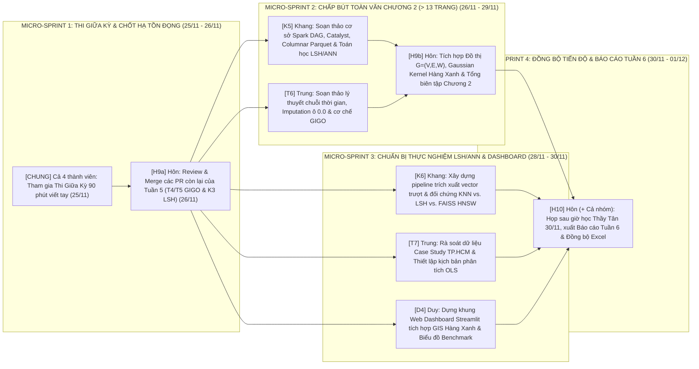

# KẾ HOẠCH THỰC HIỆN ĐỒ ÁN TUẦN 6 (25/11 – 01/12/2026)
## MÔN: PHÂN TÍCH DỮ LIỆU LỚN (`BIG DATA ANALYTICS`) — NHÓM 11

> **Khoảng thời gian:** Thứ Tư `25/11/2026` – Thứ Ba `01/12/2026` *(Tuần 6 — Hoàn thành Thi Giữa Kỳ, Toàn văn Chương 2 (> 13 trang), và Triển khai Đối chứng Thuật toán LSH vs. FAISS)*  
> **Giảng viên hướng dẫn:** TS. Hà Minh Tân *(Lịch học cố định: Chiều/Tối Thứ Hai hàng tuần — buổi họp kế tiếp: `30/11/2026`)*  
> **Tài liệu tham chiếu:** [De_Cuong_Chi_Tiet_Do_An_Phan_Tich_Du_Lieu_Lon.md](./De_Cuong_Chi_Tiet_Do_An_Phan_Tich_Du_Lieu_Lon.md) | [Ke_Hoach_Thuc_Hien_Tuan_5.md](./Ke_Hoach_Thuc_Hien_Tuan_5.md) | [05_report_slides/draft_chuong_2_do_thi_g_v_e_w.md](./05_report_slides/draft_chuong_2_do_thi_g_v_e_w.md) | [03_benchmarks_similarity/benchmark_summary_pems_bay.md](./03_benchmarks_similarity/benchmark_summary_pems_bay.md)  
> **Trọng tâm Tuần 6:** Hoàn tất bài thi giữa kỳ 90 phút trên lớp; nghiệm thu dứt điểm các nhánh làm sạch dữ liệu GIGO và smoke-test vectorizer; khai thác sớm kết quả benchmark scaling $1\text{M} \to 17\text{M}$ dòng từ PR #6; chấp bút toàn văn **Chương 2 chuyên sâu cơ sở toán học & kiến trúc phân tán ($> 13$ trang)** nạp vào file Word chính thức; và khởi động bộ khung **Web Dashboard (`Streamlit/Folium`)** sẵn sàng cho Tuần 7.

---

## I. BỐI CẢNH & ĐIỂM TỰA TỪ TUẦN 5 CHUYỂN SANG TUẦN 6

Tuần 5 đã khép lại với nhiều kết quả bứt phá, tạo tiền đề đặc biệt thuận lợi cho Tuần 6:
1. **Nghiệm thu thành công PR #6 (Vũ Văn Duy):** Đã hợp nhất vào nhánh `main` toàn bộ khung đo kiểm tài nguyên `benchmark_profiler.py` (`[D1]`), bản đồ GIS Folium kiểm chứng 20 nút Hàng Xanh và 207 cảm biến METR-LA (`[D2]`, đạt $100\%$ PASS kiểm định nghiêm ngặt `--strict`), cùng kết quả benchmark đối chứng Pandas vs. PySpark mở rộng từ $1\text{M} \to 17\text{M}$ dòng trên PEMS-BAY (`[D3]`). Điểm gãy bộ nhớ của Pandas (OOM ở rolling window 17M dòng trong khi PySpark ổn định ở $4.18\text{s}$) là phát hiện thực nghiệm cốt lõi làm sáng rõ giá trị đề tài.
2. **Nền tảng học thuật đã sẵn sàng:** Toàn văn Phần Mở đầu & Chương 1 ($10–12$ trang kèm Bảng 1.1) đã nằm gọn trong [Khung_Bao_Cao_Do_An_Phan_Tich_Du_Lieu_Lon.docx](./Khung_Bao_Cao_Do_An_Phan_Tich_Du_Lieu_Lon.docx). Chuyên đề toán học đồ thị không gian $G=(V, E, W)$ và ma trận trọng số Gaussian Hàng Xanh (`draft_chuong_2_do_thi_g_v_e_w.md`) đã sẵn sàng để tích hợp vào Chương 2.
3. **Mục tiêu then chốt Tuần 6:** Hoàn thành thi giữa kỳ; giải quyết dứt điểm các PR còn lại của Tuần 5 (làm sạch GIGO và smoke-test LSH/ANN); viết hoàn chỉnh Chương 2 ($> 13$ trang chuẩn rubric `YeuCau`); và bước đầu chuẩn bị đối chứng thuật toán quy mô lớn cho Tuần 7.

---

## II. SƠ ĐỒ PHỤ THUỘC ĐẦU VIỆC TUẦN 6

---

## III. MA TRẬN PHỤ THUỘC TỔNG HỢP GIỮA 4 THÀNH VIÊN TRONG TUẦN 6

| Thành viên | MSSV | Đầu việc làm được NGAY (Không chờ ai) | Đầu việc PHẢI CHỜ người khác | Vai trò mở khóa cho toàn nhóm |
| :--- | :---: | :--- | :--- | :--- |
| **Trần Hoàng Hôn** *(Trưởng nhóm / PM & Đồ thị TP.HCM)* | `26410046` | • Thi giữa kỳ (25/11). • Tích hợp phần Đồ thị $G=(V,E,W)$ và Ma trận Gaussian vào Chương 2 từ file `draft_chuong_2_do_thi_g_v_e_w.md`. | • `[M_W5]` (Chờ Trung & Khang đẩy nốt code Tuần 5 để merge dứt điểm). • Chờ đóng góp mục Spark/LSH của Khang và mục GIGO của Trung để ráp hoàn chỉnh Chương 2. | **Chủ trì chất lượng Chương 2 & Kỷ luật tiến độ:** Đảm bảo toàn văn Chương 2 vượt ngưỡng $13$ trang chuẩn học thuật; điều phối họp sync và xuất bản Báo cáo Tuần 6. |
| **Nguyễn Duy Khang** *(Kỹ sư PySpark & Thuật toán LSH/ANN)* | `26410055` | • Thi giữa kỳ (25/11). • Soạn cơ sở toán học LSH (hàm băm ngẫu nhiên chiếu Cosine/Euclid) và FAISS (đồ thị phân tầng HNSW) cho Chương 2. | • `[K6]` Cần dữ liệu sạch từ pipeline GIGO của Trung (`data/interim/metr_la_cleaned.parquet/`) để trích xuất vector trượt quy mô lớn. | **Trụ cột toán học thuật toán & Kiến trúc tính toán:** Chịu trách nhiệm bảo đảm tính chính xác của công thức băm LSH và đồ thị tìm kiếm ANN; thiết kế pipeline vector hóa. |
| **Phạm Thành Trung** *(Kỹ sư Thu thập & Tiền xử lý GIGO)* | `26410141` | • Thi giữa kỳ (25/11). • Soạn thảo thuyết minh cơ chế nội suy tuyến tính có chặn và xử lý ngoại lai IQR cho Chương 2. | • `[T7]` Thiết lập kịch bản phân tích OLS (cần làm rõ nguyên tắc chỉ chạy OLS khi dữ liệu giao thông–thời tiết khớp địa điểm và thời gian quan sát). | **Bảo chứng chất lượng dữ liệu sạch:** Đóng gói hoàn chỉnh tập dữ liệu sạch Parquet, cung cấp bằng chứng thống kê GIGO trước và sau làm sạch phục vụ Báo cáo. |
| **Vũ Văn Duy** *(Kỹ sư Benchmark & Trực quan hóa)* | `26410031` | • Thi giữa kỳ (25/11). • Đã hoàn thành trước kịch bản Benchmark scaling 1M–17M dòng (`[D3]`). • Xây dựng khung Web Dashboard `Streamlit` (`04_hcm_dashboard/app.py`). | • `[D4]` Tích hợp thêm các chỉ số tương đồng và kết quả truy vấn từ module `[K6]` của Khang khi hoàn thành. | **Trực quan hóa & Giao diện ứng dụng:** Đưa các số liệu benchmark và bản đồ GIS tương tác vào ứng dụng web trực quan, phục vụ demo và slide báo cáo. |

---

## IV. KẾ HOẠCH CHI TIẾT TỪNG THÀNH VIÊN TRONG TUẦN 6 (25/11 – 01/12/2026)

### 1. Trần Hoàng Hôn (`26410046`) — Trưởng nhóm / PM & Kiến trúc Đồ thị TP.HCM
*Định mức thời gian Tuần 6: ~3.5–4.0 giờ (Tập trung tổng biên tập Chương 2 & điều phối)*

| Mã CV & Hạn | Đầu việc Đồ án | Đầu vào (Inputs) | Trọng tâm thực hiện | Sản phẩm bàn giao (Deliverables) |
| :--- | :--- | :--- | :--- | :--- |
| **`[CHUNG]`** 25/11 | Tham gia Kỳ thi Giữa kỳ môn Phân tích Dữ liệu Lớn | • Kiến thức phân tán Spark, HDFS, MapReduce, LSH, KNN | • Tự luận viết tay 90 phút trên lớp TS. Hà Minh Tân | • Bài thi giữa kỳ hoàn tất |
| **`[H9a]`** 26/11 | Review kỹ thuật & Hợp nhất các PR còn lại của Tuần 5 | • PR làm sạch GIGO của Trung (`[T4]`, `[T5]`) • PR smoke-test LSH của Khang (`[K3]`) | • Rà soát mã nguồn, kiểm tra data contract Parquet, giải quyết xung đột (nếu có) và merge vào `main` | • Nhánh `main` tích hợp đủ pipeline làm sạch GIGO và vectorizer |
| **`[H9b]`** 27/11 – 29/11 | Chấp bút & Tổng biên tập toàn văn **Chương 2 ($> 13$ trang)** nạp vào Khung Báo cáo Word | • `05_report_slides/draft_chuong_2_do_thi_g_v_e_w.md` • Đóng góp lý thuyết Spark/LSH từ Khang (`[K5]`) • Đóng góp quy trình GIGO từ Trung (`[T6]`) | • Soạn thảo cấu trúc 5 mục chuyên sâu theo đề cương: (2.1) Kiến trúc Spark & Parquet; (2.2) Lý thuyết chuỗi thời gian & GIGO; (2.3) Không gian đồ thị $G=(V,E,W)$ & Gaussian; (2.4) Toán học LSH & FAISS HNSW; (2.5) Hồi quy OLS đa biến. • Nạp trực tiếp vào file Word [Khung_Bao_Cao_Do_An_Phan_Tich_Du_Lieu_Lon.docx](./Khung_Bao_Cao_Do_An_Phan_Tich_Du_Lieu_Lon.docx) | • File markdown `05_report_slides/draft_toan_van_chuong_2.md` • Khung Báo cáo Word cập nhật trọn vẹn Chương 2 đạt dung lượng $\ge 13$ trang chuẩn học thuật |
| **`[H10]`** 30/11 – 01/12 | Họp sync nhóm sau giờ học Thầy Tân, xuất bản Báo cáo Tuần 6 & Đồng bộ Excel | • Ghi chú buổi học tối 30/11 • Tiến độ thực tế 4 thành viên | • Đánh giá hoàn thành công việc Tuần 6, lập kế hoạch Tuần 7; xuất file `Bao_Cao_Tuan_6_Phan_Tich_Du_Lieu_Lon.docx` và cập nhật file Excel | • File Word `Bao_Cao_Tuan_6_Phan_Tich_Du_Lieu_Lon.docx` • File Excel [Ke_Hoach_Thuc_Hien_Do_An_Phan_Tich_Du_Lieu_Lon.xlsx](./Ke_Hoach_Thuc_Hien_Do_An_Phan_Tich_Du_Lieu_Lon.xlsx) cập nhật Tuần 6 |

---

### 2. Nguyễn Duy Khang (`26410055`) — Kỹ sư PySpark & Thuật toán Big Data (`LSH`/`ANN`)
*Định mức thời gian Tuần 6: ~3.5–4.0 giờ*

| Mã CV & Hạn | Đầu việc Đồ án | Đầu vào (Inputs) | Trọng tâm thực hiện | Sản phẩm bàn giao (Deliverables) |
| :--- | :--- | :--- | :--- | :--- |
| **`[CHUNG]`** 25/11 | Tham gia Kỳ thi Giữa kỳ môn Phân tích Dữ liệu Lớn | • Kiến thức phân tán Spark, LSH, cấu trúc dữ liệu lớn | • Tự luận viết tay 90 phút trên lớp | • Bài thi giữa kỳ hoàn tất |
| **`[K5]`** 26/11 – 28/11 | Soạn thảo cơ sở lý thuyết tính toán phân tán Spark & Toán học LSH / FAISS cho Chương 2 | • Giáo trình môn học, công trình Indyk 1998, Johnson 2019, Zaharia 2016 | • Thuyết minh cơ chế Spark DAG, Catalyst Optimizer, Tungsten Engine, định dạng lưu trữ cột Parquet Snappy. • Thiết lập hệ thống công thức toán học hoàn chỉnh cho phép băm cục bộ `BucketedRandomProjectionLSH` (chiếu ngẫu nhiên, xác suất đụng độ $p_1, p_2$) và thuật toán đồ thị phân tầng `FAISS HNSW` (độ phức tạp $\mathcal{O}(\log N)$) | • Đoạn văn bản lý thuyết và hệ thống công thức $\LaTeX$ đóng góp cho Chương 2 tại `05_report_slides/draft_c2_spark_lsh_math.md` |
| **`[K6]`** 28/11 – 30/11 | Xây dựng pipeline vector trượt & kịch bản đối chứng **Exact KNN vs. LSH vs. FAISS** | • Dữ liệu sạch `data/interim/metr_la_cleaned.parquet/` từ `[T5]` • Script smoke-test `smoke_test_lsh_faiss.py` từ `[K3]` | • Tạo vector đặc trưng chuỗi thời gian cửa sổ trượt (sliding window 12 bước = 60 phút, vector 12 chiều). • Thiết lập kịch bản đối chứng 3 thuật toán: (1) Exact KNN vét cạn (chuẩn đối chứng tuyệt đối); (2) Spark LSH; (3) FAISS IndexHNSWFlat. • Đo đạc sơ bộ: `Recall@10`, `Query Latency (ms)` và thời gian lập chỉ mục (`Build Index Time`) | • Script `03_benchmarks_similarity/benchmark_knn_lsh_faiss.py` • Nhật ký đo đạc sơ bộ chuẩn bị cho Tuần 7 |

---

### 3. Phạm Thành Trung (`26410141`) — Kỹ sư Thu thập & Tiền xử lý GIGO
*Định mức thời gian Tuần 6: ~3.0–3.5 giờ*

| Mã CV & Hạn | Đầu việc Đồ án | Đầu vào (Inputs) | Trọng tâm thực hiện | Sản phẩm bàn giao (Deliverables) |
| :--- | :--- | :--- | :--- | :--- |
| **`[CHUNG]`** 25/11 | Tham gia Kỳ thi Giữa kỳ môn Phân tích Dữ liệu Lớn | • Kiến thức phân tích dữ liệu, tiền xử lý, kiến trúc hệ thống | • Tự luận viết tay 90 phút trên lớp | • Bài thi giữa kỳ hoàn tất |
| **`[T6]`** 26/11 – 28/11 | Soạn thảo thuyết minh quy trình xử lý GIGO & Cơ chế nội suy cho Chương 2 | • `01_data_ingestion/gigo_audit_report.md` • Mã nguồn làm sạch từ `[T4]`, `[T5]` | • Trình bày cơ sở toán học của bài toán dữ liệu rác trong chuỗi thời gian giao thông. • So sánh phân tích: tại sao không xóa bỏ dòng mang giá trị 0.0 (sẽ phá vỡ lưới thời gian đều 5 phút) mà phải dùng nội suy cục bộ kết hợp forward-fill có chặn. • Thống kê đối chứng phân bố dữ liệu trước và sau làm sạch (Mean, Std, Min, Max, tỷ lệ lỗi $0.0\%$) | • Mục văn bản thuyết minh GIGO đóng góp cho Chương 2 tại `05_report_slides/draft_c2_gigo_imputation.md` |
| **`[T7]`** 28/11 – 30/11 | Chuẩn bị dữ liệu Case Study TP.HCM & Thiết lập kịch bản phân tích hồi quy OLS | • Dữ liệu thời tiết Open-Meteo `open_meteo_hcm_sample.csv` • Đồ thị Hàng Xanh 20 nút, 37 cạnh | • Khảo sát khả năng thu thập dữ liệu tốc độ giao thông thực tế tại khu vực Hàng Xanh. • Khẳng định nguyên tắc học thuật: chỉ phân tích hồi quy OLS mưa–tốc độ khi có dữ liệu cùng không gian và thời gian; tuyệt đối không ghép chéo dữ liệu thời tiết TP.HCM với cảm biến METR-LA/PEMS-BAY tại Mỹ. • Chuẩn bị khung phân tích tương quan cho Case Study Tuần 7 | • Tài liệu phân tích thiết kế Case Study TP.HCM `04_hcm_dashboard/case_study_hcm_design.md` |

---

### 4. Vũ Văn Duy (`26410031`) — Kỹ sư Benchmark Hiệu năng & Trực quan hóa
*Định mức thời gian Tuần 6: ~3.0–3.5 giờ (Kế thừa thành quả hoàn thành sớm ở PR #6)*

| Mã CV & Hạn | Đầu việc Đồ án | Đầu vào (Inputs) | Trọng tâm thực hiện | Sản phẩm bàn giao (Deliverables) |
| :--- | :--- | :--- | :--- | :--- |
| **`[CHUNG]`** 25/11 | Tham gia Kỳ thi Giữa kỳ môn Phân tích Dữ liệu Lớn | • Kiến thức MapReduce, Spark, đo kiểm tài nguyên | • Tự luận viết tay 90 phút trên lớp | • Bài thi giữa kỳ hoàn tất |
| **`[D4]`** 26/11 – 29/11 | Xây dựng bộ khung ứng dụng Web Dashboard tương tác (`Streamlit`) | • Bản đồ Folium Hàng Xanh `hang_xanh_gis_check.html` • Bản đồ cảm biến METR-LA `metr_la_sensors_map.html` • 3 biểu đồ Benchmark PNG từ PR #6 | • Khởi tạo ứng dụng `Streamlit` đa trang (`Multi-page App`):   - Trang 1: Tổng quan đề tài & Kiến trúc Big Data Pipeline.   - Trang 2: GIS Inspection — Tương tác bản đồ Hàng Xanh (20 nút, 37 cạnh) & METR-LA (207 cảm biến phân tầng zero sentinel).   - Trang 3: Benchmark Explorer — Bảng tương tác và biểu đồ so sánh hiệu năng Pandas vs. PySpark ($1\text{M} \to 17\text{M}$ dòng). | • Script ứng dụng `04_hcm_dashboard/app.py` • Hướng dẫn chạy cục bộ trong file `04_hcm_dashboard/README.md` |
| **`[D5]`** 29/11 – 30/11 | Soạn thảo thuyết minh phân tích thực nghiệm Benchmark phục vụ Chương 3 | • `03_benchmarks_similarity/benchmark_summary_pems_bay.md` • `benchmark_results.csv` | • Diễn giải sâu sắc các biểu đồ: giải thích hiện tượng Spark chậm hơn ở quy mô nhỏ do overhead khởi tạo JVM/partition, và vượt trội hoàn toàn khi dữ liệu lớn nhờ cơ chế xử lý theo khối và tối ưu hóa bộ nhớ. • Làm nổi bật sự kiện Pandas chạm trần bộ nhớ OOM tại bài toán rolling mean 17M dòng | • Bản thảo phân tích thực nghiệm đóng góp cho Chương 3 tại `05_report_slides/draft_c3_benchmark_analysis.md` |

---

## V. CHECKLIST NGHIỆM THU TUẦN 6 (`DEFINITION OF DONE`)

Toàn bộ công việc Tuần 6 được nghiệm thu theo các tiêu chí khắt khe bám sát đề cương chi tiết:

- [ ] **Kỳ thi Giữa kỳ (`Cả 4 thành viên`):** 100% 4 thành viên tham gia đầy đủ kỳ thi giữa kỳ 90 phút viết tay trên lớp vào chiều/tối Thứ Hai ngày 25/11/2026.
- [ ] **Hợp nhất Dữ liệu GIGO & Vectorizer (`[H9a]`, `[T5]`, `[K3]`):** Hoàn tất merge PR của Trung và Khang; xác nhận tập dữ liệu sạch `data/interim/metr_la_cleaned.parquet/` và script trích xuất vector trượt vận hành thông suốt.
- [ ] **Toàn văn Chương 2 ($> 13$ trang chuẩn học thuật) (`[H9b]`, `[K5]`, `[T6]`):** Hoàn thành bản thảo toàn văn Chương 2 và nạp thành công vào [Khung_Bao_Cao_Do_An_Phan_Tich_Du_Lieu_Lon.docx](./Khung_Bao_Cao_Do_An_Phan_Tich_Du_Lieu_Lon.docx); bảo đảm đầy đủ 5 trụ cột lý thuyết (Spark DAG/Tungsten/Parquet, GIGO Imputation, Đồ thị không gian $G=(V,E,W)$ & Gaussian kernel Hàng Xanh, Toán học LSH Cosine/Euclidean và FAISS HNSW, Cơ sở hồi quy OLS).
- [ ] **Khung Thực nghiệm Đối chứng LSH vs. FAISS (`[K6]`):** Hoàn thành script `benchmark_knn_lsh_faiss.py`, chạy thử nghiệm đo đạc sơ bộ trên tập vector đặc trưng, sẵn sàng chạy mẻ lớn ở Tuần 7.
- [ ] **Ứng dụng Web Dashboard Streamlit (`[D4]`):** Hoàn thành bộ khung `04_hcm_dashboard/app.py`, chạy thông suốt cục bộ, tích hợp thành công bản đồ GIS tương tác và biểu đồ benchmark hiệu năng.
- [ ] **Hồ sơ Tiến độ & Họp Sync Tuần 6 (`[H10]`):** Họp sync nhóm sau giờ học ngày 30/11; xuất bản file Word `Bao_Cao_Tuan_6_Phan_Tich_Du_Lieu_Lon.docx` đúng biểu mẫu CITD; cập nhật mức độ hoàn thành Tuần 6 lên $\ge 80\%$ trong [Ke_Hoach_Thuc_Hien_Do_An_Phan_Tich_Du_Lieu_Lon.xlsx](./Ke_Hoach_Thuc_Hien_Do_An_Phan_Tich_Du_Lieu_Lon.xlsx).

---

## VI. ĐỐI CHIẾU MỐC CHUYỂN TIẾP SANG TUẦN 7 (02/12 – 08/12/2026)

| Mục tiêu Tuần 7 | Đầu vào cần thiết bàn giao từ Tuần 6 | Thành viên phụ trách chính |
| :--- | :--- | :--- |
| **Thực nghiệm đối chứng toàn diện: Exact KNN vs. LSH vs. ANN (FAISS HNSW)** | Script `benchmark_knn_lsh_faiss.py` (`[K6]`) + Vector trượt từ dữ liệu sạch `[T5]` | **Nguyễn Duy Khang & Vũ Văn Duy** |
| **Triển khai Case Study TP.HCM & Tương quan Thời tiết** | Tài liệu thiết kế Case Study `[T7]` + Đồ thị Hàng Xanh 20 nút | **Phạm Thành Trung & Trần Hoàng Hôn** |
| **Hoàn thành toàn văn Chương 3 (> 13 trang thực nghiệm & phân tích)** | Số liệu đối chứng LSH/ANN + Phân tích Benchmark từ `[D5]` + Số liệu Case Study TP.HCM | **Vũ Văn Duy & Phạm Thành Trung** (Hôn tổng biên tập) |
| **Nâng cấp Web Dashboard thành sản phẩm hoàn chỉnh** | Ứng dụng Streamlit `[D4]` + Tab kết quả đối chứng LSH/ANN mới | **Vũ Văn Duy** |
